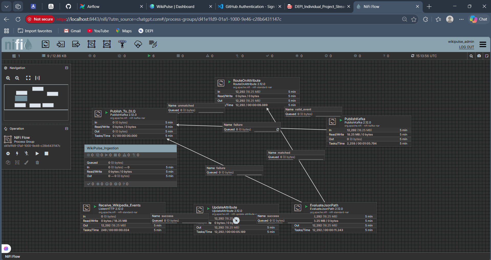
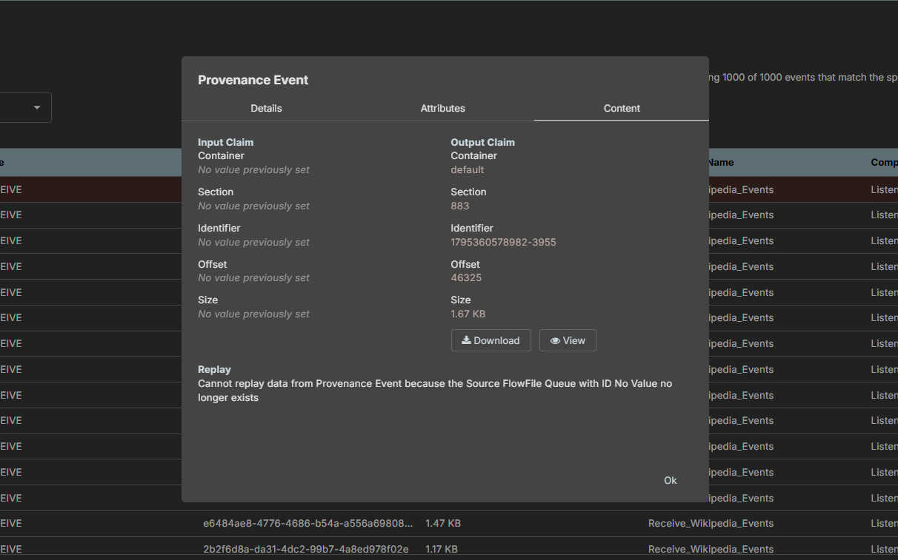
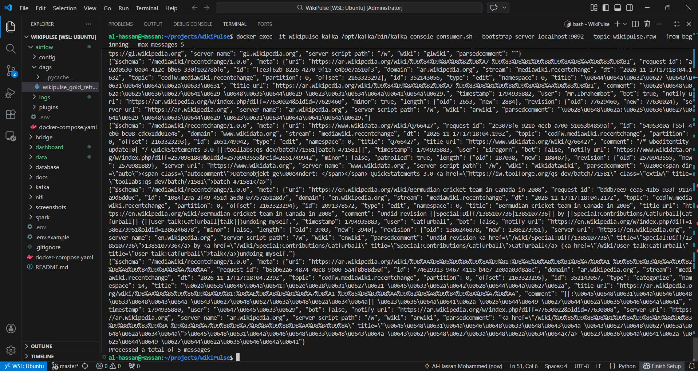
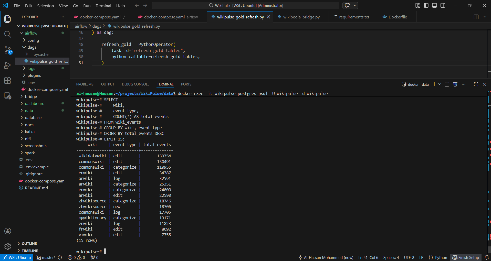
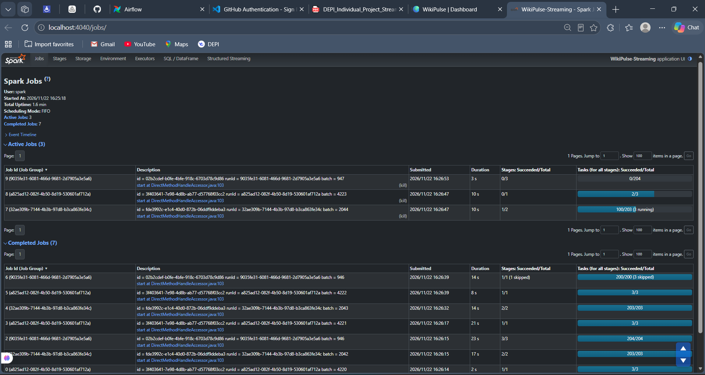

# WikiPulse – Real-Time Wikipedia Activity Monitoring Platform

WikiPulse is a real-time data engineering platform designed to collect, process, store, and analyze live Wikipedia activity events.

The platform captures live events from Wikipedia, processes streaming data through a distributed data pipeline, stores data in a multi-layer data lake, and delivers analytical insights through an interactive dashboard.

---

## Architecture

```text
Wikipedia EventStreams
        │
        ▼
   Python Bridge
        │
        ▼
     Apache NiFi
        │
        ▼
     Apache Kafka
        │
        ▼
Spark Structured Streaming
        │
        ├── Bronze Layer
        │
        └── Silver Layer
                │
                ▼
          PostgreSQL
                │
                ▼
           Gold Layer
                │
                ▼
       Streamlit Dashboard

Apache Airflow orchestrates scheduled Gold-layer refreshes.
```

---

## Tech Stack

| Technology | Purpose |
|---|---|
| Python | Data collection and event processing |
| Apache NiFi | Data flow management and ingestion |
| Apache Kafka | Distributed event streaming |
| Apache Spark Structured Streaming | Real-time data processing |
| Parquet | Data lake storage format |
| PostgreSQL | Analytics and data storage |
| Apache Airflow | Workflow orchestration |
| Streamlit | Interactive dashboard |
| Docker | Containerization |
| Docker Compose | Multi-service deployment |

---

## Data Pipeline

### 1. Data Ingestion

Live events are collected from Wikipedia EventStreams through a Python bridge.

### 2. Data Flow Management

Apache NiFi manages the event flow and routes incoming data through the ingestion pipeline.

### 3. Event Streaming

Apache Kafka acts as the distributed streaming backbone, allowing event-driven communication between pipeline components.

### 4. Stream Processing

Apache Spark Structured Streaming processes incoming events in real time.

### 5. Data Lake

Processed events are stored in Parquet format using a layered architecture:

- **Bronze Layer:** Raw event data.
- **Silver Layer:** Processed and structured data.

### 6. Analytics Database

PostgreSQL stores structured event data and analytical information used by the dashboard.

### 7. Gold Layer

The Gold layer provides aggregated analytical data for reporting and insights.

### 8. Workflow Orchestration

Apache Airflow automates and schedules Gold-layer data refresh workflows.

### 9. Dashboard

Streamlit provides an interactive interface for monitoring Wikipedia activity and exploring analytics.

---

## Dashboard Features

- Total event monitoring
- Recent Wikipedia activity
- Wikipedia project monitoring
- Unique editors analysis
- Event activity tracking
- Hourly activity trends
- Interactive analytics

---

## Resilience

WikiPulse includes resilience testing to evaluate pipeline behavior during service interruptions and recovery scenarios.

The distributed architecture allows individual components to be restarted while the pipeline continues recovering and processing incoming data.

---

## Project Structure

```text
WikiPulse/
├── airflow/
│   └── dags/
├── bridge/
├── dashboard/
├── data/
│   ├── bronze/
│   ├── silver/
│   └── checkpoints/
├── database/
├── docs/
├── kafka/
├── nifi/
├── screenshots/
├── spark/
│   └── jobs/
├── docker-compose.yaml
├── .env.example
├── .gitignore
└── README.md
```

---

## Screenshots

### NiFi Data Flow



### NiFi Provenance




### Kafka Topics


### Kafka Event Streaming



### PostgreSQL Analytics



### Resilience Test


### Docker Containers


### Live Dashboard


### Spark Jobs



### Spark Stages


---

## Future Improvements

- Advanced monitoring and observability
- Additional real-time analytics
- Improved alerting mechanisms
- Expanded dashboard visualizations
- Performance optimization

---

## Author

**Abdullah Hassan**

Communication and Electronics Engineering  
Data Engineering | Real-Time Streaming | Distributed Data Systems
