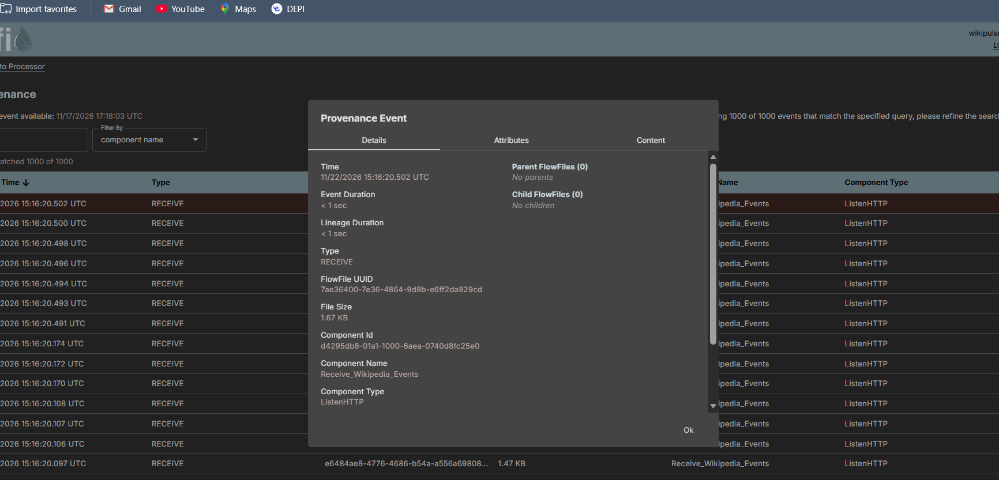
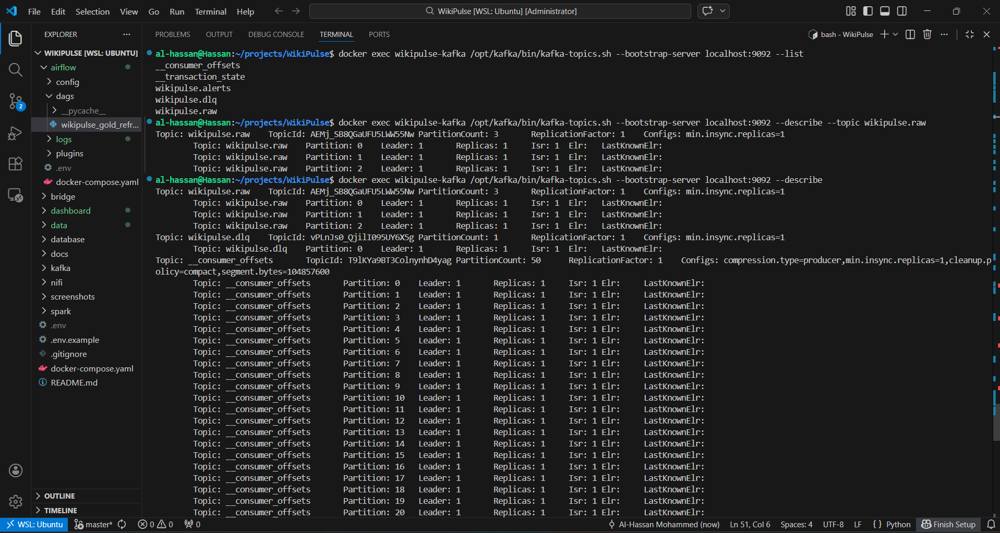
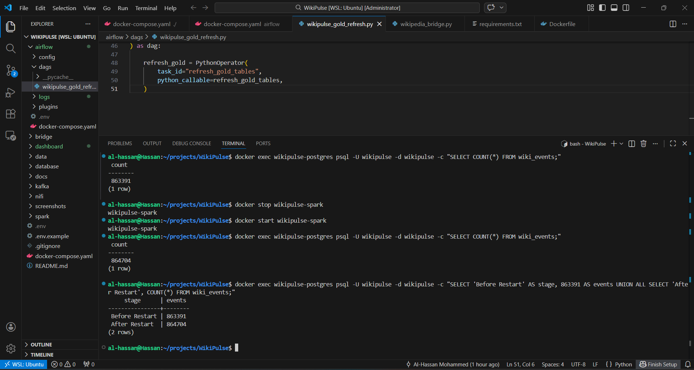
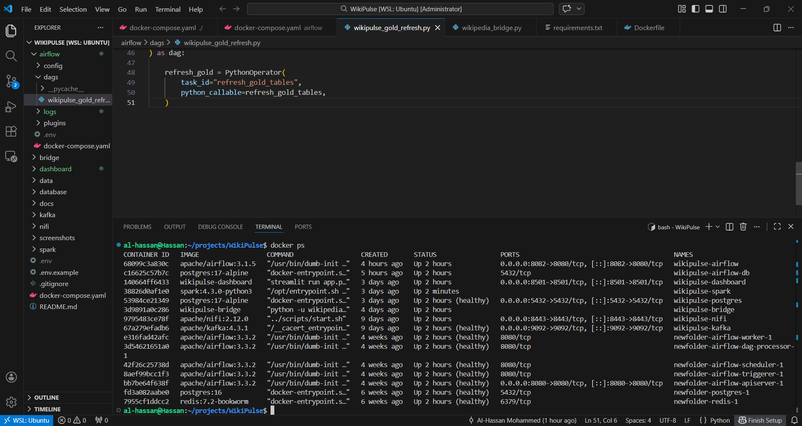
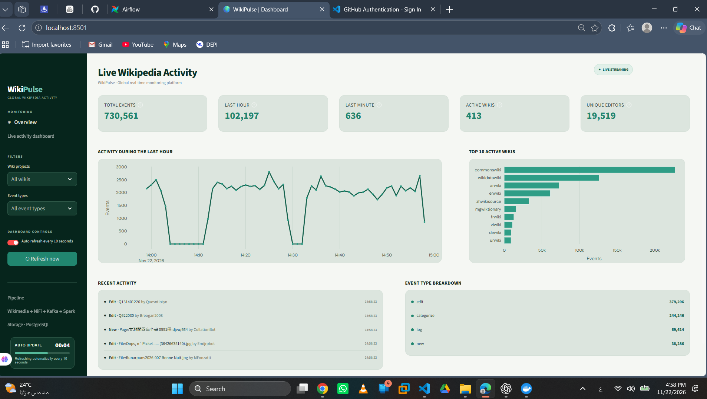
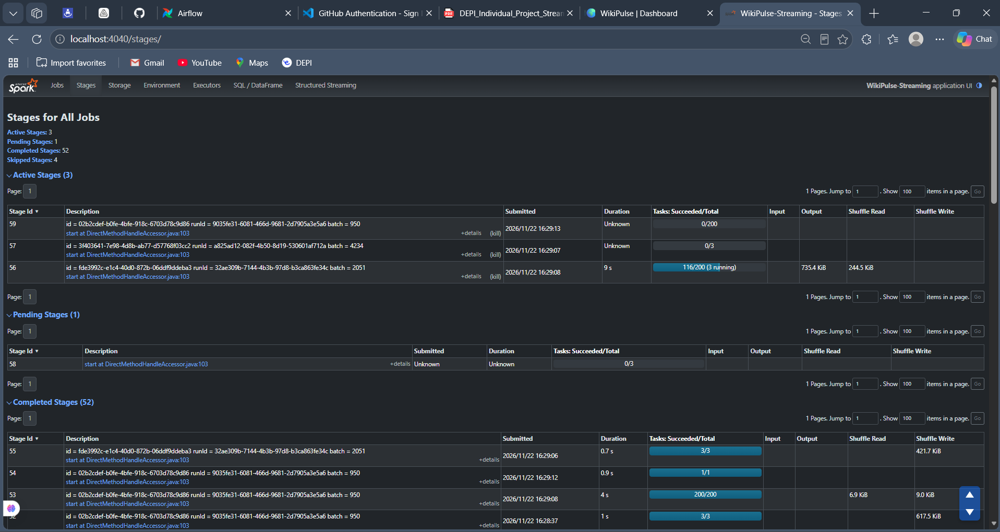

# WikiPulse – Real-Time Wikipedia Activity Monitoring Platform

WikiPulse is a real-time data engineering platform designed to collect, process, store, and analyze live Wikipedia activity events.

The platform streams Wikipedia events through a distributed data pipeline, processes incoming data in real time, stores processed data in a structured format, and provides analytics through an interactive dashboard.

---

## Architecture

Wikipedia EventStreams → Python Bridge → Apache NiFi → Apache Kafka → Apache Spark Structured Streaming → Bronze & Silver Data Layers → PostgreSQL → Gold Analytics → Streamlit Dashboard

Apache Airflow orchestrates scheduled Gold-layer data refreshes.

---

## Tech Stack

- **Python** – Event collection and data processing
- **Apache Kafka** – Real-time event streaming
- **Apache NiFi** – Data flow management and ingestion
- **Apache Spark Structured Streaming** – Stream processing
- **Parquet** – Data storage format
- **PostgreSQL** – Analytics database
- **Apache Airflow** – Workflow orchestration
- **Streamlit** – Interactive dashboard
- **Docker & Docker Compose** – Containerization

---

## Data Pipeline

### 1. Real-Time Data Ingestion
Live Wikipedia events are collected from Wikipedia EventStreams and forwarded through a Python bridge.

### 2. Data Flow Management
Apache NiFi manages the incoming event flow and routes events into Kafka.

### 3. Streaming Infrastructure
Apache Kafka acts as the event streaming backbone, enabling reliable communication between pipeline components.

### 4. Stream Processing
Apache Spark Structured Streaming processes incoming events and organizes data into different layers.

### 5. Data Lake
Processed data is stored in Parquet format using a layered architecture:

- **Bronze:** Raw event data
- **Silver:** Processed and structured data

### 6. Analytics Layer
PostgreSQL stores analytical data and serves as the backend for dashboard queries.

### 7. Gold Layer
Gold tables provide aggregated and analytical datasets, including:

- Wiki activity analytics
- Event metrics
- User activity
- Hourly activity trends

### 8. Workflow Orchestration
Apache Airflow automatically schedules Gold-layer refreshes.

### 9. Dashboard
Streamlit provides an interactive dashboard for monitoring Wikipedia activity and exploring real-time metrics.

---

## Dashboard Features

- Total Wikipedia events
- Recent event activity
- Active Wikipedia projects
- Unique editors
- Event activity monitoring
- Hourly activity analytics
- Wiki activity insights

---

## Project Structure

```text
WikiPulse/
├── airflow/
│   ├── dags/
│   └── docker-compose.yaml
├── bridge/
├── dashboard/
├── data/
│   ├── bronze/
│   ├── silver/
│   └── checkpoints/
├── database/
├── docs/
├── kafka/
├── nifi/
├── screenshots/
├── spark/
│   └── jobs/
├── docker-compose.yaml
├── .env.example
├── .gitignore
└── README.md
---

## Screenshots

### NiFi Data Flow


### NiFi Provenance


### Kafka Topics


### Kafka Event Streaming


### PostgreSQL Analytics


### Resilience Test


### Docker Containers


### Live Dashboard


### Spark Jobs


### Spark Stages

